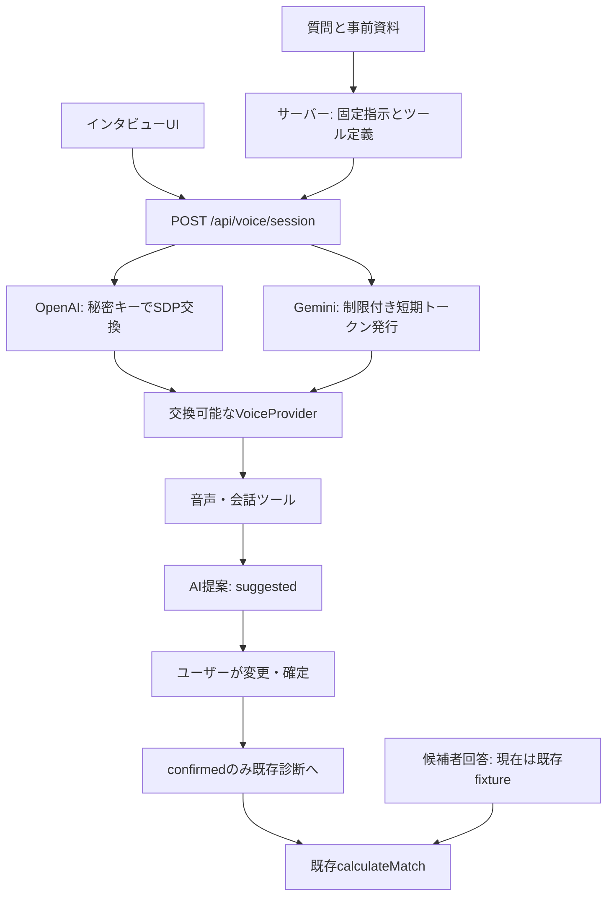

# オシセン AI音声インタビュー MVP

現在のGemini 3.8 / Project11対応の新規Sites版は [GEMINI38-SITES.md](./GEMINI38-SITES.md) を参照。以下は元のMVPの設計・検証履歴。

2026-09-15 / 実装ブランチ `feat/voice-interview-demo`

## 現在の状態

`/interview` に公共交通・子育て・防災の3問を追加。通常診断の `/questions` から入れる。API未設定でも選択肢で3問に回答し、既存 `/results` まで進める。

2026-09-15、ユーザー指定のEdgeタブからGoogle AI Studioの既存無料枠キーを取得し、Git対象外の `.env.local` に権限600で設定した。秘密キーはクライアントやログに含めない。Gemini 3.1 Flash Liveの短期トークン発行、Live APIへの接続、架空テキストの `agree` 提案、PCM音声応答を実APIで確認済み。Edgeで合成日本語音声を使い、3問の回答候補（agree / skip / strongly_agree）、手動修正・確定・設問移動・出典表示を確認済み。実機マイクと人間による自然さの評価は未実施。詳細はQA.md。

OpenAI連携はユーザー側で再接続済みだが、コネクタ側は認証エラーのまま。2.1 / Mini の実音声比較は未検証。カード課金・公開デプロイは行っていない。

対象コードは公開リポジトリ `Louis-Takeuchi/oshisen` の `f1ecdd51c276e3879289e10ba45e694282d75e41` から取得した。既存コードには8問と4人の**仮名候補者**、結果確認用の回答fixtureがある。候補者本人の回答は未掲載。本デモの結果も既存の「デモ結果」表示を維持する。実在候補者との一致度は表示しない。

## 起動

Node.js 22.13以上。リポジトリルートで以下を実行する。

```sh
npm ci
test -f .env.local || cp .env.example .env.local
chmod 600 .env.local
npm run dev:vercel -- --hostname 127.0.0.1 --port 3100
```

`http://127.0.0.1:3100/interview` を開く。`.env.local` の `OPENAI_API_KEY` または `GEMINI_API_KEY` を安全なローカル編集手段で設定する。チャットやGitへキーを貼らない。設定後は開発サーバーを再起動する。

デフォルトは `gpt-realtime-2.1`。UIで `gpt-realtime-2.1-mini` と `gemini-3.1-flash-live-preview` に切り替える。モデル名は許可リストで固定し、無断で別モデルへ置換しない。利用権限・残高・無料枠は接続先アカウントに依存する。

ローカル開発以外では `VOICE_ALLOWED_ORIGIN` と `VOICE_DEMO_ACCESS_CODE` が必須。コードは画面で入力し、ブラウザに保存しない。一般公開は未実施。公開運用前に通常の認証、利用者単位の分散レート制限、プロバイダー側予算上限を追加する。現行の1プロセス毎時20接続制限とクライアントの10分停止は厳密な課金上限ではない。

iPhoneで使う場合はHTTPSが必要。今回のブラウザ検証は390px幅のデスクトップブラウザであり、実機Safariのマイク・Bluetooth・音声割り込みは未検証。

## 採用した構造



- `lib/questions.ts`: 設問だけを候補者データから分離。既存 `lib/data.ts` の再exportにより既存呼び出しを維持。
- `lib/voice/catalog.ts`: 3問、モデル許可リスト、事前資料。候補者モジュールをimportしない。
- `lib/voice/domain.ts`: 回答enum、推定・選択・確定、古いイベント拒否、既存回答への変換。
- `lib/voice/prompt.ts`: 中立な面接方針と `suggest_answer` / `ask_clarification` / `show_sources`。確定・候補者取得・推薦のツールは提供しない。
- `lib/voice/server.ts`: 入力上限・オリジン・アクセスコード・モデル検証、秘密キーの利用、プロバイダー応答のサニタイズ。
- `lib/voice/providers`: 音声接続の詳細を閉じ込める。OpenAIはWebRTC、GeminiはSDK WebSocketとAudioWorklet PCM。将来のSTT→LLM→Mapper→TTSも同じ `VoiceProvider` イベントへ適合できる。
- `components/voice/use-interview.ts`: 接続、設問revision、ツール処理、画面状態、確定操作、計測の制御。
- `components/voice/interview.tsx`: スマートフォン向けUI。音声状態・短い現在字幕・回答候補・資料・修正を表示。

### データと会話の境界

音声プロバイダーへ送るのは設問・資料・面接指示・ユーザー発話・ツール応答。候補者名、政党、候補者回答、順位、一致率を送らない。モデルが知識として候補者を知っている可能性はプロンプトだけでは消せないため、推薦をしない方針も併用する。

`suggested` は推定、`selected` は画面上の選択、`confirmed` はユーザーがボタンで確定した値。AIツールは `confirmed` に書けない。手動選択を後から届いた提案が上書きしない。設問IDとrevisionで古い設問・再接続前のイベントを拒否する。

明確な発言は提案を表示して待ち、毎回の音声確認は求めない。曖昧なときだけ短い確認を1回許可する。2回目の確認ツールは拒否する。ただし音声モデルがツールを使わず確認質問を発話することまで、このMVPは機械的に完全制御できない。実評価で遵守率を確認する必要がある。

| 音声側の回答 | 既存値 |
|---|---:|
| strongly_agree | 4 |
| agree | 3 |
| neutral | 2 |
| disagree | 1 |
| strongly_disagree | 0 |
| skip | null |

判断不能・知識不足を `neutral` にしない。`basis: insufficient_knowledge / declined` の提案は `skip` だけを受け付ける。

確定時だけ既存の `sessionStorage` 診断へ反映する。3問終了時には、通常診断で残りを回答するか、残りの未回答を明示的に見送って結果へ進むかを選べる。既に確定してある他の回答は保持する。

一致度は変更していない `lib/matching.ts` の `round(100 × (1 − Σ|本人−候補者| / (4 × 共通回答数)))`。`skip` は分母から除外し、共通回答が0なら値はnull。生成AIは計算に関与しない。

### API

`GET /api/voice/config`: 許可モデル・設定済みか・Gemini無料枠フラグ・アクセスコード要否・デモ時間を返す。キーは返さない。

`POST /api/voice/session`: JSON `{model, questionId, revision, sdp?, syntheticOnly?}`。OpenAIはSDP、Geminiは短期トークンだけを返す。任意のinstructionsやtoolsをクライアントから受け付けない。65536バイト上限、上流20秒タイムアウト、no-store。エラー本文へプロバイダーの生応答を出さない。

OpenAIの秘密キーはサーバーから `/v1/realtime/calls` にだけ使用。ブラウザは返されたSDPで直接音声通信する。Geminiはモデル・システム指示・ツールを制約した1回限り、開始猶予1分、有効10分のトークンを使用。両者とも長期キーをクライアントバンドルに含めない。Googleの現行ガイドに従いv1betaを使用するが、導入済みSDKにはv1alphaを案内する古い警告文が残っている。v1betaで短期トークン接続と音声応答が実際に成功することを確認した。

## プライバシーと資料

アプリは音声録音ファイルを作らず、ユーザー文字起こしを要求・保存しない。現在のAI字幕はメモリ内だけ。画面を離れたら音声接続・マイク・再生を停止する。運営DBや解析サービスへの発話本文送信は実装していない。プロバイダーでの保持は各契約・設定に従い、ZDRを保証しない。

Gemini無料枠は機微情報を含む実際の政治的意見の収集に利用しない。UIとサーバーで架空の開発用発言への同意を必須とする。`VOICE_GEMINI_FREE_TIER=false` は、実際の課金・データ取扱条件を確認した環境だけで設定する。

各資料に発行元、URL、確認日、根拠として使える範囲、限界を記録。2026-09-15に確認した国交省の地域交通・インフラ維持管理、こども家庭庁の児童手当の一次資料を収録。国の制度資料であり、県の予算増額の効果を直接立証するものではない。賛成・慎重の論点は編集上の整理で、発行元の政策提言として引用しない。資料の専門家レビューや選挙対象地域の予算資料追加は未実施。

## 比較評価

モデル別の接続試行をメモリ内で記録。終了後に評価JSONを明示的にダウンロードできる。モデル、プロンプト版、接続時間、応答時間、提案・確定回答、変更有無、confidence、確認回数、割り込み回数、利用トークン、終了状態、本人評価を含む。モデル切替・再接続時には未確定のAI提案を消し、手動選択と確定済み回答を維持する。以前のモデルの提案・confidenceを新しい試行へ混ぜない。確認質問の上限は設問内で維持し、計測だけを試行開始時との差分にする。

修正率は理解の正解率ではない。正解率は本人の評価と組み合わせて判断する。Geminiの発話終了はローカル音量による概測で、OpenAIと完全に同一条件ではない。費用は検証済み単価を未設定のため `null`（未算定）。プロバイダー請求額との照合は未実施。画面を閉じると未ダウンロードの計測は失われる。実離脱率の集計、複数接続をまたぐ総完了時間、料金集計基盤は次段階。

## 参照したAPI仕様

- [OpenAI WebRTC](https://developers.openai.com/api/docs/guides/voice-webrtc?api=realtime)
- [GPT-Realtime-2.1](https://developers.openai.com/api/docs/models/gpt-realtime-2.1)
- [GPT-Realtime-2.1 Mini](https://developers.openai.com/api/docs/models/gpt-realtime-2.1-mini)
- [Gemini短期トークン](https://ai.google.dev/gemini-api/docs/live-api/ephemeral-tokens) — v1beta
- [Gemini利用条件](https://ai.google.dev/gemini-api/terms)

UI比較と検証記録は [QA.md](./QA.md) を参照。

比較評価用の架空発言24件は [evaluation-cases.json](./evaluation-cases.json)、採点手順は [evaluation-guide.md](./evaluation-guide.md)。実測値はまだ含まない。

2026-09-16追記: Sol/Lunaレビュー修正後の128テストと両ビルド・lintが成功。復旧したEdgeでGemini合成音声3問から回答一覧・既存結果まで確認。3問目の候補生成後に接続期限通知で音声が停止したが、確定と結果表示は継続できた。実機・OpenAI比較は引き続き未検証。
